# odjezdy-system

Náhodný vibecoded systém pro lidi, kteří prostě chtějí mít odjezdovou tabuli na počítači jako systém.

Počítač (VM, starý notebook, mini-PC u monitoru) nabootuje rovnou do **LED odjezdové tabule** s živými daty z [odjezdy.online](https://app.odjezdy.online). Ve výchozím stavu používá skutečný BUSE panelový font, ale umí i vzhled tabulí z jiných zemí.

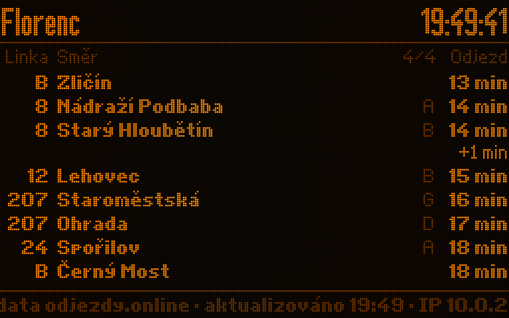

## Varianty

| | Stav | Pro koho |
|---|---|---|
| [`alpine/`](alpine/README.md): **live ISO** | hotové, bootuje v QEMU | Rychle vyzkoušet. Běží z RAM (~380 MB ISO, 1 GB RAM), nic neinstaluje. |
| `arch/`: **plnohodnotný OS s instalátorem** | ve vývoji | Normální Arch Linux (pacman, systemd), instalace na disk, GUI tabule jako hlavní rozhraní. |

Obě varianty používají stejnou aplikaci z [`app/`](app/). Tabule kreslí přímo do framebufferu (`/dev/fb0`), bez X serveru a bez prohlížeče:
- **LCD vzhledy** (DB, SBB) kreslí v plném rozlišení vyhlazeným písmem z TTF, stejně jako prohlížeč nebo SVG (vlastní rasterizér nad opentype.js).
- **UK** kreslí text taky vektorově a pak ho převede na kulaté LED body („LED síto“): hladké tvary písmen jako v prohlížeči, ale složené z bodů.
- **BUSE** používá skutečný bitmapový panelový font (bod po bodu jako originál). RATP a JR zatím používají bitmapy převedené z písem.

## Vzhledy tabulí

Vzhled se přepíná klávesou **T** nebo v úvodním menu. Většina vzhledů se sama přizpůsobí druhu zastávky: nádraží (čas, vlak, kolej) se zobrazuje jinak než zastávka MHD (linka, cíl, minuty).

| BUSE (Česko) | UK National Rail | Deutsche Bahn |
|---|---|---|
| 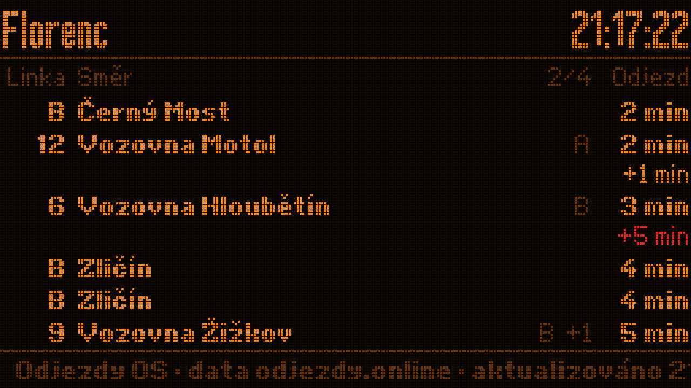 | 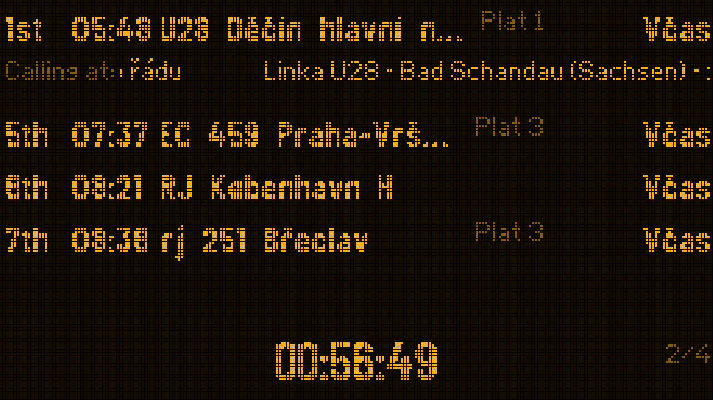 | 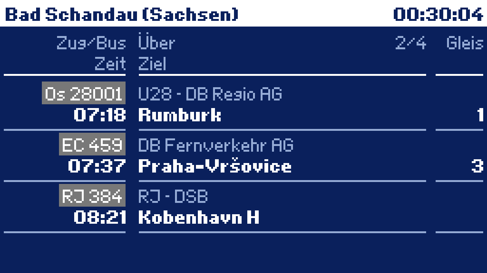 |
| **UK: Countdown (bus)** | **DB: městská zastávka** | **SBB (Švýcarsko)** |
| 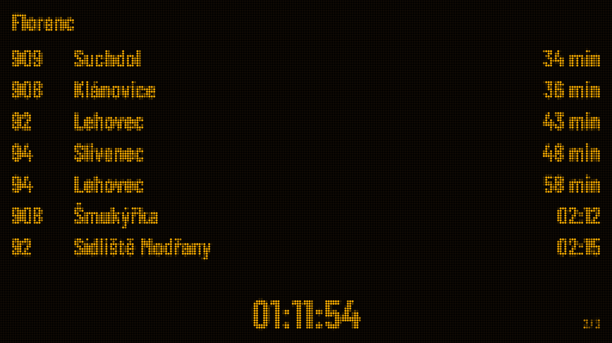 | 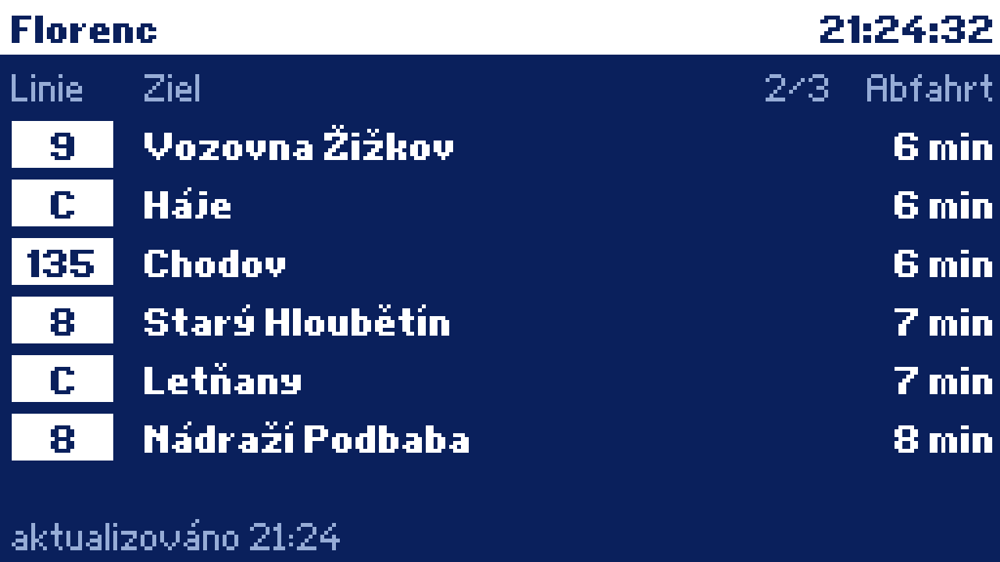 | 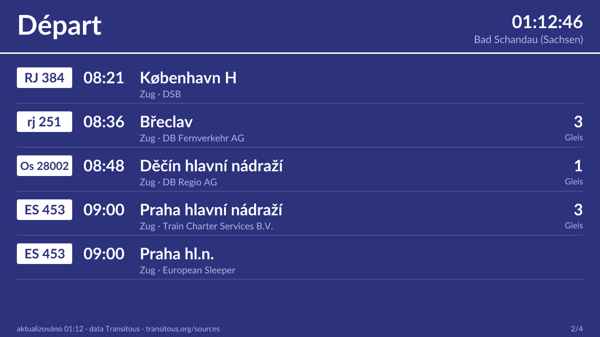 |
| **RATP SIEL (Paříž)** | **JR (Japonsko)** | **Výběr podle kraje** |
| 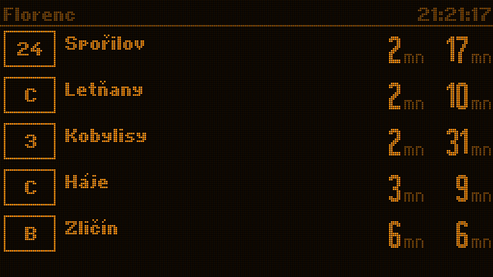 | 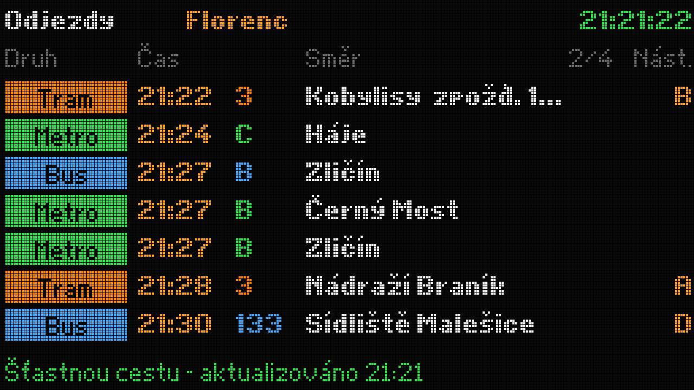 | 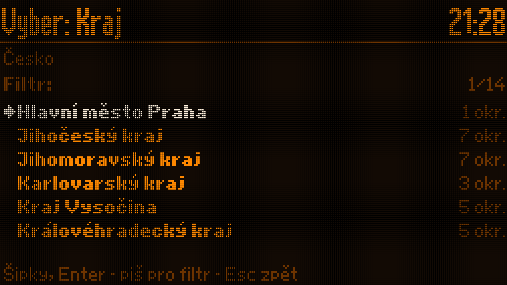 |
| **NS (Nizozemsko)** | **Solari (překlápěcí tabule)** | **Neon (fiktivní)** |
| 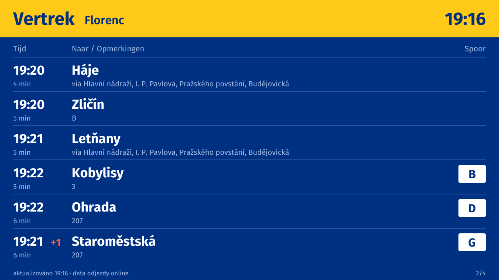 | 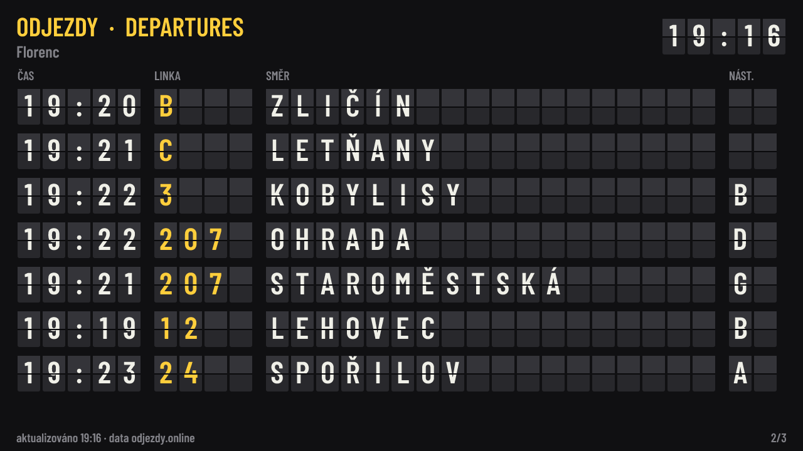 | 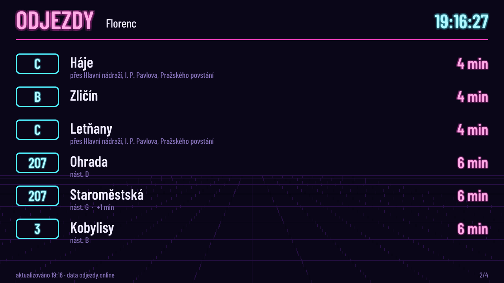 |
| **E-ink (fiktivní)** | **Zelená LED (fiktivní)** | **Mimořádnost** |
| 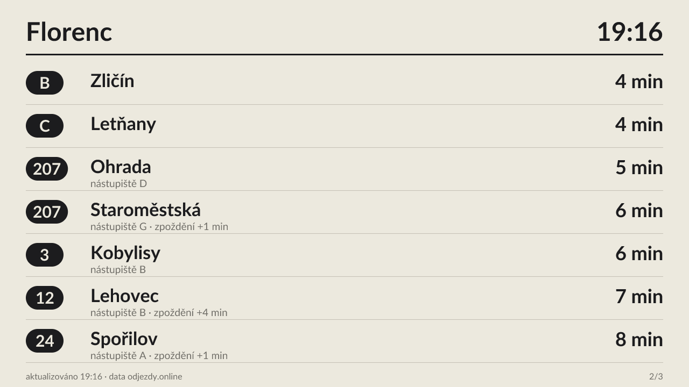 | 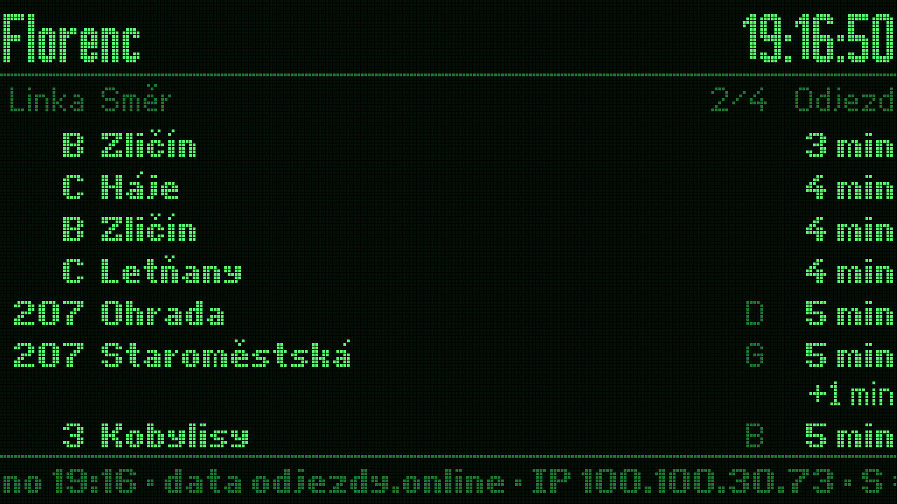 | 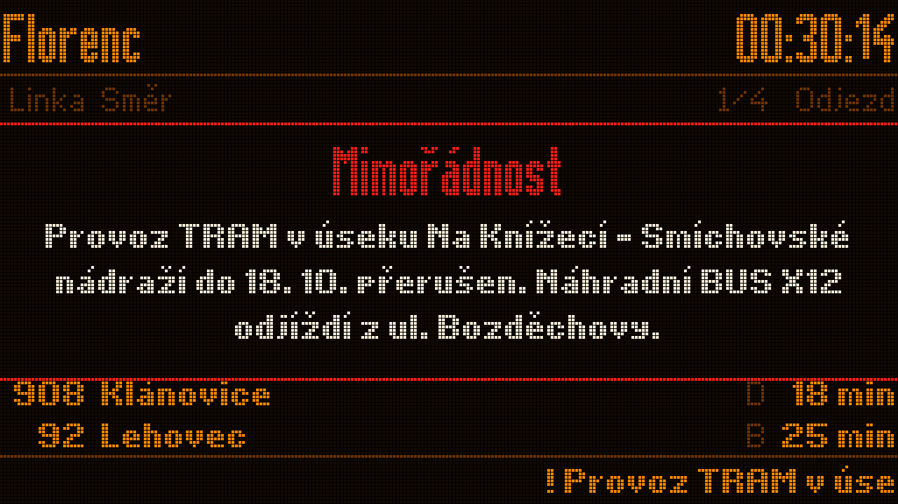 |
| **Nastavení vzhledu** | | |
| 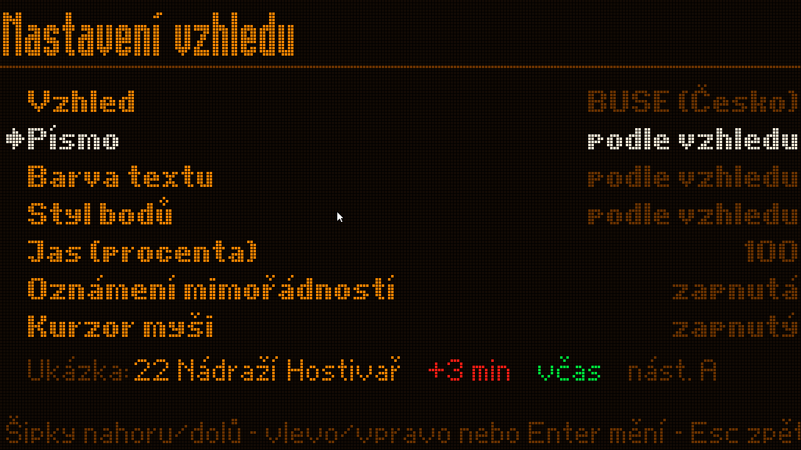 | | |

Při mimořádnosti (výluka zastávky, zrušený spoj) se přes jakýkoli vzhled pravidelně ukáže celoobrazovkové oznámení **Mimořádnost**. V nastavení jde vypnout.

Vlastní vzhled zvládne kdokoli. Je to jeden JS soubor, návod je v **[docs/THEMES.md](docs/THEMES.md)**.

## Ovládání

| Klávesa | Akce |
|---|---|
| `S` / `Enter` | menu: poslední zastávka, předvolby, **výběr podle kraje → okresu → obce**, hledání |
| `T` | další vzhled tabule |
| myš | kurzor, klikání v menu, kolečko listuje, pravé tlačítko = zpět (v nastavení jde kurzor vypnout) |
| `1`–`9` | rychlé přepnutí na naposledy použité zastávky |
| `Q` | ukončit tabuli a otevřít shell (`exit` ji spustí znovu) |
| `Alt+F2` | servisní konzole |

## Stažení a aktualizace

Hotová ISO jsou v **[Releases](https://github.com/odjezdy-online/odjezdy-system/releases)**. Sestavuje je GitHub Actions ([`release.yml`](.github/workflows/release.yml)) automaticky: stačí na `main` změnit číslo v [`app/VERSION`](app/VERSION) (např. `0.5.0`) a workflow vytvoří tag `v0.5.0`, sestaví ISO a zveřejní vydání. Verze, která už vydaná je, se přeskočí. Jde to i ručně tagem nebo přes *Actions → Release → Run workflow*. Ke každému vydání patří i balíček aplikace `odjezdy-app.tar.gz` s kontrolním součtem.

Běžící tabule se jednou za 6 hodin podívá, jestli nevyšla nová verze. Když ano, ukáže obrazovku **Aktualizace** a zeptá se: *Aktualizovat / Později / Tuto verzi přeskočit*. Bez odpovědi se po 2 minutách vrátí na tabuli. Ručně jde aktualizace spustit v menu (`S` → *Aktualizace*). V nastavení se dá přepnout na *automaticky* nebo *vypnuté*.

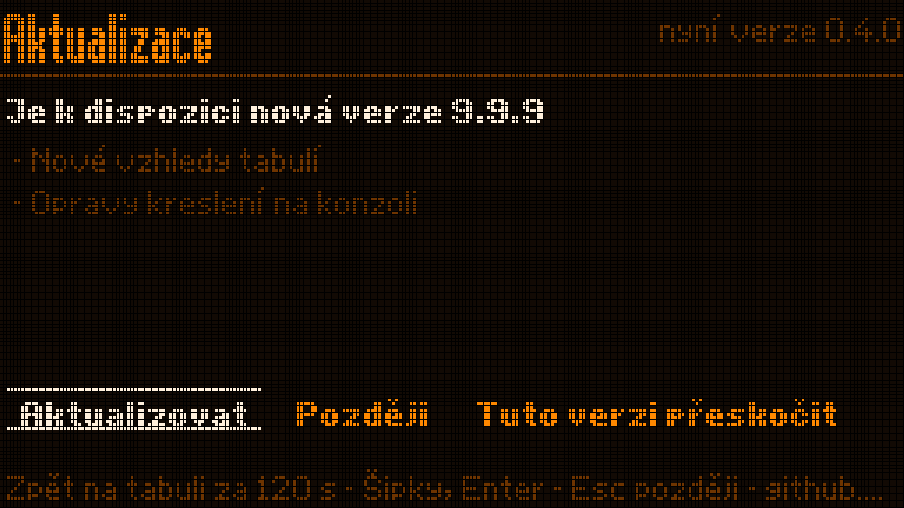

Jak to funguje ([`app/updater.js`](app/updater.js)):
- Stažený balíček se ověří podle SHA-256 a rozbalí do `/var/lib/odjezdy/app`. Aplikace z ISO nebo z balíčku se nemění, při startu jen předá řízení novější verzi.
- Když nová verze nevydrží běžet ani 20 s, při dalším startu se automaticky vrátí ta původní a tahle verze se už nenabídne.
- Na živém Alpine ISO se aktualizace po restartu ztratí, pokud médium není zapisovatelné (`lbu commit`). Tabule se pak zeptá znovu.

## Struktura

```
app/            aplikace tabule (Node.js, bez závislostí)
  board.js      data, vykreslování LED/LCD matice, menu, výběr zastávky
  updater.js    aktualizace z GitHub Releases (ověření, rozbalení, návrat zpět)
  VERSION       verze aplikace (při vydání ji přepíše workflow podle tagu)
  themes/       vzhledy tabulí (buse, uk, db, sbb, ns, ratp, jr, solari, neon, eink, zelena), _util.js a _simple.js
  font.json     BUSE panelový font převedený z odjezdy.online (tools/fnt2json.js)
  stops.json.gz index 43 tisíc zastávek
  regions.json.gz  kraje → okresy → obce se zastávkami (tools/build-regions.js)
alpine/         live ISO (Alpine Linux 3.24, diskless), build na Windows/macOS/Linux
tools/          převod fontu, stavba indexu krajů, ovládání QEMU (screenshoty)
docs/           návody a screenshoty
```

Aplikace jde vyzkoušet bez VM, vyrenderuje jeden snímek do PNG:

```
cd app && node board.js --png out.png --theme db
```

## Data a zdroje

- Odjezdy, výluky a zastávky v Česku: [odjezdy.online](https://app.odjezdy.online) (PID, DÚK, IDSJMK, ODIS, CIS JŘ a další).
- Zastávky ve světě a čísla vlaků: [Transitous](https://transitous.org) (MOTIS 2 API, komunitní služba pro open-source a nekomerční projekty). **Zdroje dat: [transitous.org/sources](https://transitous.org/sources/)**, tabule je uvádí ve stavovém řádku. Transitous využívá i data © přispěvatelů OpenStreetMap.
- BUSE font: `/cedulomat/font.fnt` z odjezdy.online, formát z OMSI BUSE TOOL.
- Písma pro zahraniční vzhledy (SIL Open Font License 1.1, Google Fonts): **Fira Sans**, **Lato** a **Barlow Condensed** jako TTF v `app/fonts/ttf/` (licence vedle souborů), **Inter**, **Source Sans 3**, **Barlow Condensed** a **DotGothic16** převedené do LED bitmap (`app/fonts/*.json`, `tools/fontgen.js`).
- [opentype.js](https://opentype.js.org) 1.3.4 (MIT) v `app/vendor/`: čtení TTF pro vektorové LCD vzhledy.
- Obce, okresy a kraje: číselníky ČSÚ se souřadnicemi obcí (souradnice.csv z [33bcdd/souradnice-mest](https://github.com/33bcdd/souradnice-mest)). V repu je jen odvozené přiřazení zastávek.

## Licence

Kód je pod licencí [MIT](LICENSE). Data mají vlastní podmínky zdrojů (viz výše). Data z Transitous se smí používat jen nekomerčně.
